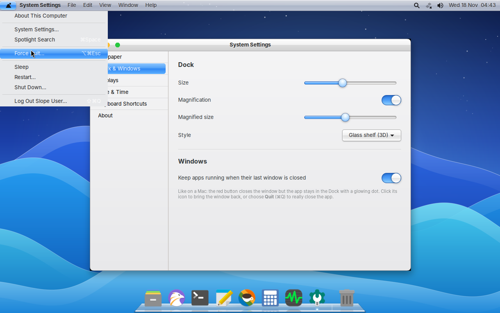
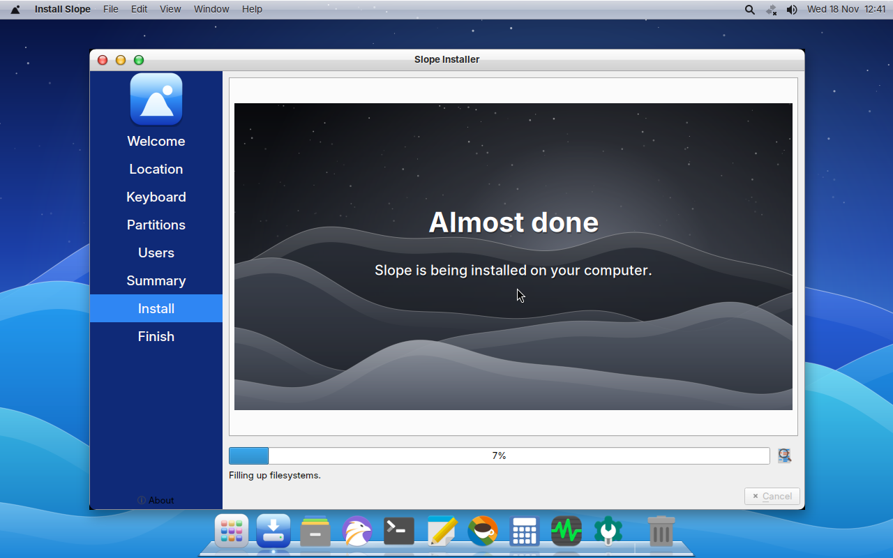
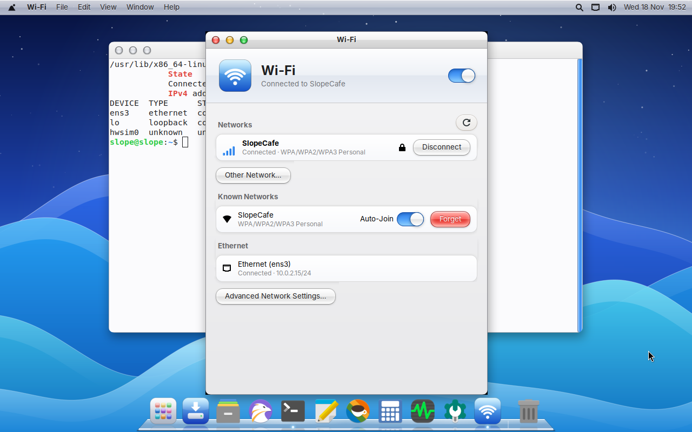

# Slope

**Slope** is a Linux-based operating system with its own glossy, glassy desktop
that feels like macOS. It boots as a live ISO, from a USB stick or a virtual
machine.



| TextEdit running | …after clicking the red ✕: window gone, app still running |
|---|---|
|  |  |

| Launchpad | Installer |
|---|---|
|  |  |

| Wi-Fi (iwd) |
|---|
|  |

*(Screenshots from the actual ISO booted in QEMU, and from a Slope system installed with it.)*

- **Global menu bar** at the top. The menus of the focused app (File, Edit,
  View…) live in the top bar, not inside the window. This works for GTK apps
  (through `appmenu-gtk-module`) and Qt apps. Apps that don't export a menu
  get standard File / Edit / View / Window / Help menus that send the usual
  shortcuts.
- **Dock** at the bottom: a 3D glass shelf with reflections, magnifying icons,
  bouncing launches, glowing "running" dots, name tooltips and right-click
  menus (Keep in Dock, Quit, the app's window list…).
- **Glossy Mac-style windows**: shiny red / yellow / green gel buttons on the
  left (with ×, − and + on hover, graphite glass when the window is in the
  background), soft shadows and rounded corners. Slope ships small patches to
  Openbox (`packages/openbox/`) so title-bar buttons can be full-colour PNGs.
- **Every app gets the Slope window frame**, including apps that normally draw
  their own title bar: GNOME / libadwaita and other GTK 4 apps, GTK 3 apps
  with header bars, Firefox, Thunderbird, Chrome and Electron apps (VS Code,
  Discord…). Their own title bar becomes a toolbar under the Slope frame, and
  their own window buttons are switched off, so there's one set of traffic
  lights everywhere.
- **Launchpad**: the first icon in the Dock (also F4 or ⌘A). It's a full-screen
  frosted grid of every installed app. Type to search, click to open, or
  right-click → **Keep in Dock**.
- **Installer**: double-click **Install Slope** in the Dock of the live
  session, or use the welcome window that opens at start-up. The graphical
  installer (Calamares) partitions the disk (erase, alongside another OS, or
  manual), creates your user and installs the GRUB boot loader for BIOS or
  UEFI.
- **Closing a window never quits the app**, just like on a Mac. The red ✕
  (also ⌘W, Alt+F4 and Close Window in the title-bar right-click menu) really
  closes the window: you're asked to save changes, and the window is gone, not
  minimized. But the app keeps running with no windows: it stays in the Dock
  with its glowing dot. Click the Dock icon, or open the app from Launchpad or
  Spotlight, and you get a **fresh new window**. To really quit, use **Quit**
  in the app menu, **⌘Q** (Super+Q), or right-click the Dock icon → **Quit**.
  This works for GTK apps (all the bundled apps, GNOME apps, Xfce apps), opened
  from the Dock, Launchpad, Spotlight, the file manager or Slope's shortcuts.
  Apps that can't run without a window (Firefox, Chrome, Qt and Electron apps)
  get their last window hidden instead, and it comes back as it was.
- **Crazy glassy shiny widgets**: Aqua-style gel buttons, a pulsing blue
  default button, gel scrollbars, candy progress bars with moving stripes,
  glossy sliders and switches, frosted translucent menus.
- **Wi-Fi app** (iwd): a glossy window with a Wi-Fi on/off switch, nearby
  networks with signal bars, Join / Disconnect, hidden networks
  ("Other Network…"), saved networks with Auto-Join and Forget, and the
  Ethernet status. The top bar's network menu lists the same networks, and
  you can join them from there; it asks for the password when needed.
- **Wired internet works out of the box**: plug in a cable and NetworkManager
  connects. DNS goes through systemd-resolved.
- **Animations**: windows zoom in when they open and shrink away when they
  close. Minimizing or closing an app's last window shrinks it into the Dock,
  and it grows back out when restored. Dock icons pop in and out, Launchpad
  zooms, Spotlight slides in and wallpapers cross-fade. Slope back-ports
  picom 12 for this (`packages/picom/`).
- **Top-bar popovers** for Sound (volume slider, mute, output device) and the
  Clock (calendar).
- **Slope icon theme**: every app icon sits on the same glossy porcelain tile.
  When you install something with `apt`, a hook (`/etc/apt/apt.conf.d/99slope-icons`)
  makes its tile straight away. Popular apps (Firefox, VS Code, Steam, Discord,
  VLC, GIMP…) are pre-made. Apps or windows with no icon at all get a glossy
  one with their initials. Run `sudo slope-icons --rebuild` to regenerate.
- **New apps show up by themselves**: you get a notification when an app is
  installed, and Launchpad marks it with a blue dot until you open it.
- **Games**: 32-bit (i386) packages are enabled, so Steam (`steam-installer`,
  also in the App Store) and Wine install out of the box.
- **Completely snap-free**: snap apps ignore the desktop theme, so Slope has
  no snapd, no `/snap`, no `/snap/bin` in the PATH, and apt can never install
  snapd or any of Ubuntu's "transitional" packages that secretly install a
  snap (`firefox`, `thunderbird`, `chromium-browser`, `lxd`…), not even as a
  dependency (`/etc/apt/preferences.d/no-snap.pref`). The build fails if a
  snap package sneaks in. `sudo apt install firefox` (or `thunderbird`)
  gives the real .deb from Mozilla's own repository. Ubuntu has no
  Chromium .deb, so for a Chromium-based browser use Google Chrome's,
  Brave's or Vivaldi's .deb from their websites.
- **App Store**: in the Dock. Browse about 2,000 apps by category, search,
  read descriptions and see screenshots, then install with one click (**GET**).
  It also lists installed apps (Open / Remove) and has an **Updates** tab with
  **Update All**. Everything is a normal .deb (Ubuntu's archive, plus Firefox and
  Thunderbird from Mozilla), never a snap. Installing asks for your password
  once (the live session doesn't ask). The store won't remove packages Slope
  itself needs. The catalogue is Ubuntu's AppStream data, so the store opens
  even offline.
- **Trackpad & Mouse** settings (System Settings): one natural-scrolling switch
  for the trackpad, every mouse and a virtual machine's pointer (on by default,
  like a Mac; turn it off for classic wheel-style scrolling), tap to click, two-finger or corner secondary click, two-finger or edge scrolling,
  tracking and scrolling speed, ignore-while-typing, and separate mouse
  settings. Applied at login and whenever a device is plugged in.
- **Trackpad gestures**, each one customizable in System Settings → Trackpad &
  Mouse: three- and four-finger swipes, and pinch / spread. Defaults: swipe up
  with three fingers = Launchpad, down = Show Desktop, left/right = Back/Forward,
  four fingers up = Spotlight, left/right = switch apps, four-finger pinch =
  Launchpad. Actions include Spotlight, Show Desktop, switch apps, back/forward,
  tabs, zoom, minimize/zoom/close window, hide/quit app, volume or any command.
  Slope's own small daemon (`packages/gestures/`) reads the X server's
  touchpad gestures (XInput 2.4).
- **New Private Window from the top bar**: browsers' "New Window" / "New Private
  Window" (and other apps' launcher actions) are in the app menu, in the File
  menu for apps without their own menus (like Firefox), and in the Dock's
  right-click menu. They work even when the browser has no window open.
- **Spotlight** (Super+Space): search apps, files and settings, and do quick
  maths (`12*7+3`).
- **System Settings**: wallpapers, Dock size, magnification and style, display
  resolution, clock, keyboard shortcuts. **About This Computer** and
  **Force Quit** are in the Slope (logo) menu.
- Boot splash, GRUB menu and four procedurally drawn wallpapers (Aqua Slopes,
  Sunset Ridge, Aurora, Graphite).

Under the hood it's Ubuntu 24.04 LTS (kernel, drivers, firmware, packages).
Openbox manages the windows, picom does the compositing, and the desktop shell
itself (top bar, global menu, Dock, desktop, Spotlight, Settings) is written
from scratch in Python + GTK 3 (`rootfs/usr/lib/slope/slope/`).

## Getting the ISO

### From GitHub Actions (no Linux machine needed)

Every push builds the ISO in GitHub Actions (`.github/workflows/build-iso.yml`):

1. Open the repository's **Actions** tab → **Build Slope ISO** → the latest run.
2. Download the **slope-iso** artifact. It's a zip containing `slope-1.0-amd64.iso`.

Pushing a tag such as `v1.0` also attaches the ISO to a GitHub Release.

### Build it yourself

On Ubuntu 22.04/24.04 or Debian 12+ (about 10 GB free disk space, 20–40 minutes):

```bash
sudo apt install debootstrap squashfs-tools xorriso grub-pc-bin grub-efi-amd64-bin grub-common mtools dosfstools
```

```bash
sudo ./build.sh
```

The image is written to `out/slope-<version>-amd64.iso`. Set
`SQUASHFS_COMP=zstd` for a faster (slightly bigger) build.

## Running it

- **Virtual machine**: VirtualBox, VMware, GNOME Boxes or QEMU. Give it at least
  2 GB of RAM (4 GB is better). With QEMU: `tools/run-qemu.sh out/slope-1.0-amd64.iso`.
- **Real computer**: write the ISO to a USB stick with
  [balenaEtcher](https://etcher.balena.io/), Rufus (DD mode), or
  `sudo dd if=slope-1.0-amd64.iso of=/dev/sdX bs=4M status=progress`, then
  boot from it. It works with both BIOS and UEFI. Secure Boot must be turned
  off, because the boot loader is not signed.

The live session logs in automatically as user **slope**. That user can run
`sudo` without a password.

### Installing to the disk

1. Boot the USB stick and choose **Try Slope**.
2. Click **Install Slope…** in the welcome window, or the **Install Slope** icon
   in the Dock.
3. Pick your language, time zone and keyboard, then the disk:
   - **Erase disk**: Slope takes the whole drive.
   - **Install alongside**: keeps Windows or another Linux system. GRUB lets
     you choose which one to start.
   - **Manual partitioning**: create the partitions yourself.
4. Create your user account and click **Install**. When it's finished, restart
   and remove the USB stick.

**Erase disk** really does erase everything on that drive, so back up first.
Secure Boot must be off.

## Networking

| What | Handled by |
|---|---|
| Wired (Ethernet) | NetworkManager (`/etc/NetworkManager/conf.d/20-slope.conf`) |
| Wi-Fi | iwd, including DHCP (`/etc/iwd/main.conf`). Saved networks live in `/var/lib/iwd` |
| DNS | systemd-resolved |

The installer copies Wi-Fi networks you joined in the live session to the
installed system. If a Wi-Fi card isn't found, it usually needs firmware.
Most is included (`linux-firmware`), but a few Broadcom chips need the
non-free `broadcom-sta-dkms` driver.

## Keyboard shortcuts

The **Super** (Windows) key works as the Mac **⌘ Command** key.

| Shortcut | Action |
|---|---|
| ⌘ Space | Spotlight |
| F4 / ⌘ A | Launchpad |
| ⌘ W / Alt+F4 | Close window (app keeps running) |
| ⌘ Q | Quit app |
| ⌘ H / ⌥⌘ H | Hide app / hide others |
| ⌘ M | Minimize |
| ⌘ Tab | Switch windows |
| ⌘ ↑ ← → | Zoom, tile left, tile right |
| ⌃⌘ F | Full screen |
| ⌘ , | System Settings |
| ⌥⌘ Esc | Force Quit |
| ⌘ T / ⌘ E | Terminal / Files |
| ⇧⌘ 3 or Print | Screenshot to ~/Pictures |

## Repository layout

```
build.sh                  ISO builder (debootstrap → chroot → squashfs → GRUB hybrid ISO)
config/packages.txt       packages in the image
config/chroot-setup.sh    image customisation run inside the chroot
rootfs/                   files copied into the image
  usr/lib/slope/slope/    the desktop shell (Python + GTK 3)
    shell.py              entry point: desktop, top bar and dock in one process
    panel.py              top bar, Slope menu, app menu, status icons, clock
    dbusmenu.py           global menu: AppMenu registrar + dbusmenu client
    dock.py               the glass dock
    apps.py               running-app / window tracking (libwnck)
    ctl.py, xutil.py      slope-ctl: close = hide-last-window, quit, hide…
    spotlight.py          Spotlight search
    launchpad.py          Launchpad (all apps grid)
    wifi.py, iwd.py       Wi-Fi app and iwd D-Bus client + password agent
    settings.py           System Settings, About This Computer, Force Quit
    store.py              App Store (AppStream catalogue, installs via slope-store-helper)
    inputdev.py           trackpad / mouse settings (xinput) and gestures.conf
    keepalive.py          apps that keep running with no windows
    art.py                procedural wallpapers, logo, gel drawing
  usr/share/themes/Slope/ GTK 3 theme (gtk.css) + Openbox theme (traffic lights)
  usr/share/slope/        Openbox config, picom config, xsettings, shell CSS
rootfs/etc/calamares/     installer configuration and branding
packages/openbox/         patches: full-colour PNG title-bar buttons, and a frame
                          on every app even if it asks for none
packages/keepalive/       libslope-keepalive.so: GTK apps keep running with no windows
packages/gestures/        slope-gestures: trackpad gesture daemon (XInput 2.4)
tools/gen-xbm.py          regenerates the fallback (single-colour) button bitmaps
tools/run-qemu.sh         boots the ISO in QEMU
```

### How "close keeps the app running" works

Most Linux apps quit as soon as their last window is gone. Slope preloads a
small library into the session, `libslope-keepalive.so`
(`packages/keepalive/`), that changes this for GTK apps opened as apps (from
a .desktop file):

- **GtkApplication apps** (GNOME, most Xfce and GTK 4 apps) are *held* once
  they start, so they keep running with zero windows. Opening the app again
  goes, through GLib, to the running copy, which opens a new window.
- **Older GTK apps that run `gtk_main()`** (xfce4-terminal, galculator…) quit
  with `gtk_main_quit()` when their last window closes; that call is ignored
  while no window is open.
- Apps that allow several copies of themselves (GNOME Calculator, galculator,
  Task Manager…) are marked `unique=0`. Opening one again starts a fresh copy,
  and the old windowless copy is asked to quit first.

Each such app announces itself in `$XDG_RUNTIME_DIR/slope-apps/<pid>`. The
Dock reads that to show apps without windows as running. The Openbox config
binds the red button (and ⌘W / Alt+F4) to `slope-ctl close-window`. For these
apps it really closes the window; **Quit** writes `<pid>.quit` and closes the
windows, and the app exits once none are left.

Apps the library can't keep alive (not GTK, or started from a terminal or a
script) get the fallback: their last window is marked `_SLOPE_HIDDEN`, dropped
from the task list and iconified, so the process keeps running and the Dock
icon brings the same window back. GTK tools run from scripts (zenity…) are
never held, so scripts don't hang. Set `SLOPE_NO_KEEPALIVE=1` to switch the
library off for one app. You can turn the whole behaviour off under
System Settings → Dock & Windows.

## Limitations

- Firefox, Chrome, Qt and Electron apps can't run without a window, so for them
  closing the last window only hides it (it comes back as it was). An app can
  also still quit itself from its own menus (File → Quit).
- Electron apps with their own custom title bar (VS Code, Discord…) still show
  their own buttons inside the Slope frame. In VS Code you can set
  `"window.titleBarStyle": "native"` to remove them. To leave a particular app
  without the Slope frame, add
  `<application class="Its-Class"><decor>no</decor></application>` at the end of
  the `<applications>` section in `/usr/share/slope/openbox/rc.xml`.
- Frosted-glass blur needs a real GPU. In virtual machines with software
  rendering, Slope falls back to plain translucency.
