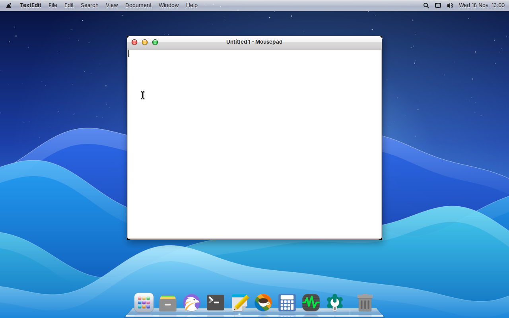
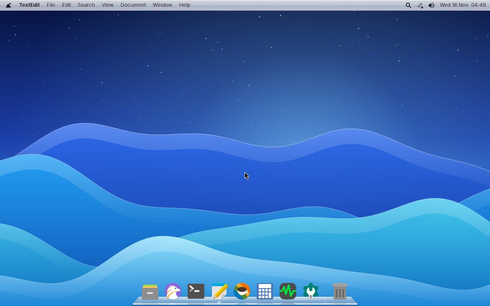
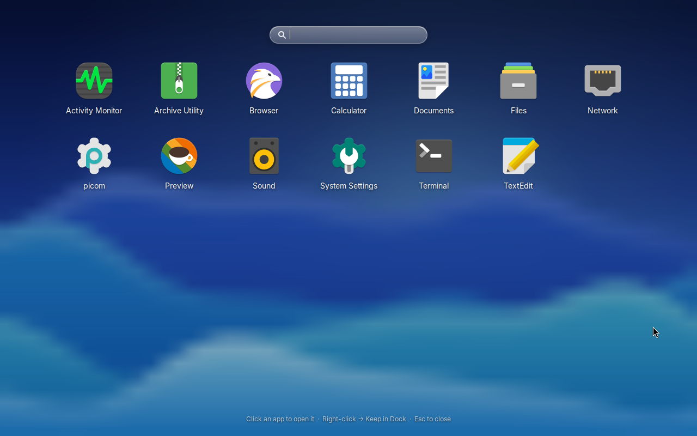

# Slope

**Slope** is a Linux-based operating system with its own glossy, glassy desktop
that feels like macOS. It boots as a live ISO, from a USB stick or a virtual
machine.


| TextEdit running | …after clicking the red ✕: window gone, app still running |
|---|---|
|  |  |

| Launchpad | Installer |
|---|---|
|  |  |

| Wi-Fi (iwd) |
|---|
|  |

*(Screenshots from the actual ISO booted in QEMU, and from a Slope system installed with it.)*

- **Global menu bar** at the top. The menus of the focused app (File, Edit,
  View…) live in the top bar, not inside the window. This works for GTK apps
  (through `appmenu-gtk-module`) and Qt apps. Apps that don't export a menu
  get standard File / Edit / View / Window / Help menus that send the usual
  shortcuts.
- **Dock** at the bottom: a 3D glass shelf with reflections, magnifying icons,
  bouncing launches, glowing "running" dots, name tooltips and right-click
  menus (Keep in Dock, Quit, the app's window list…).
- **Glossy Mac-style windows**: shiny red / yellow / green gel buttons on the
  left (with ×, − and + on hover, graphite glass when the window is in the
  background), soft shadows and rounded corners. Slope ships a small patch to
  Openbox (`packages/openbox/`) so title-bar buttons can be full-colour PNGs.
- **Launchpad**: the first icon in the Dock (also F4 or ⌘A). It's a full-screen
  frosted grid of every installed app. Type to search, click to open, or
  right-click → **Keep in Dock**.
- **Installer**: double-click **Install Slope** in the Dock of the live
  session, or use the welcome window that opens at start-up. The graphical
  installer (Calamares) partitions the disk (erase, alongside another OS, or
  manual), creates your user and installs the GRUB boot loader for BIOS or
  UEFI.
- **Closing a window does not quit the app**, just like on a Mac. The red ✕
  closes the window, but if it was the app's last window the app keeps running:
  it stays in the Dock with its glowing dot and its menu stays in the top bar.
  Click the Dock icon to bring the window back. To really quit, use
  **Quit** in the app menu, **⌘Q** (Super+Q), or right-click the Dock icon →
  **Quit**.
- **Crazy glassy shiny widgets**: Aqua-style gel buttons, a pulsing blue
  default button, gel scrollbars, candy progress bars with moving stripes,
  glossy sliders and switches, frosted translucent menus.
- **Wi-Fi app** (iwd): a glossy window with a Wi-Fi on/off switch, nearby
  networks with signal bars, Join / Disconnect, hidden networks
  ("Other Network…"), saved networks with Auto-Join and Forget, and the
  Ethernet status. The top bar's network menu lists the same networks, and
  you can join them from there; it asks for the password when needed.
- **Wired internet works out of the box**: plug in a cable and NetworkManager
  connects. DNS goes through systemd-resolved.
- **Animations**: windows zoom in when they open and shrink away when they
  close. Minimizing or closing an app's last window shrinks it into the Dock,
  and it grows back out when restored. Dock icons pop in and out, Launchpad
  zooms, Spotlight slides in and wallpapers cross-fade. Slope back-ports
  picom 12 for this (`packages/picom/`).
- **Top-bar popovers** for Sound (volume slider, mute, output device) and the
  Clock (calendar).
- **Every app gets an icon**: apps or windows that ship none get a glossy
  generated one with their initials.
- **Spotlight** (Super+Space): search apps, files and settings, and do quick
  maths (`12*7+3`).
- **System Settings**: wallpapers, Dock size, magnification and style, display
  resolution, clock, keyboard shortcuts. **About This Computer** and
  **Force Quit** are in the Slope (logo) menu.
- Boot splash, GRUB menu and four procedurally drawn wallpapers (Aqua Slopes,
  Sunset Ridge, Aurora, Graphite).

Under the hood it's Ubuntu 24.04 LTS (kernel, drivers, firmware, packages).
Openbox manages the windows, picom does the compositing, and the desktop shell
itself (top bar, global menu, Dock, desktop, Spotlight, Settings) is written
from scratch in Python + GTK 3 (`rootfs/usr/lib/slope/slope/`).

## Getting the ISO

### From GitHub Actions (no Linux machine needed)

Every push builds the ISO in GitHub Actions (`.github/workflows/build-iso.yml`):

1. Open the repository's **Actions** tab → **Build Slope ISO** → the latest run.
2. Download the **slope-iso** artifact. It's a zip containing `slope-1.0-amd64.iso`.

Pushing a tag such as `v1.0` also attaches the ISO to a GitHub Release.

### Build it yourself

On Ubuntu 22.04/24.04 or Debian 12+ (about 10 GB free disk space, 20–40 minutes):

```bash
sudo apt install debootstrap squashfs-tools xorriso grub-pc-bin grub-efi-amd64-bin grub-common mtools dosfstools
```

```bash
sudo ./build.sh
```

The image is written to `out/slope-<version>-amd64.iso`. Set
`SQUASHFS_COMP=zstd` for a faster (slightly bigger) build.

## Running it

- **Virtual machine**: VirtualBox, VMware, GNOME Boxes or QEMU. Give it at least
  2 GB of RAM (4 GB is better). With QEMU: `tools/run-qemu.sh out/slope-1.0-amd64.iso`.
- **Real computer**: write the ISO to a USB stick with
  [balenaEtcher](https://etcher.balena.io/), Rufus (DD mode), or
  `sudo dd if=slope-1.0-amd64.iso of=/dev/sdX bs=4M status=progress`, then
  boot from it. It works with both BIOS and UEFI. Secure Boot must be turned
  off, because the boot loader is not signed.

The live session logs in automatically as user **slope**. That user can run
`sudo` without a password.

### Installing to the disk

1. Boot the USB stick and choose **Try Slope**.
2. Click **Install Slope…** in the welcome window, or the **Install Slope** icon
   in the Dock.
3. Pick your language, time zone and keyboard, then the disk:
   - **Erase disk**: Slope takes the whole drive.
   - **Install alongside**: keeps Windows or another Linux system. GRUB lets
     you choose which one to start.
   - **Manual partitioning**: create the partitions yourself.
4. Create your user account and click **Install**. When it's finished, restart
   and remove the USB stick.

**Erase disk** really does erase everything on that drive, so back up first.
Secure Boot must be off.

## Networking

| What | Handled by |
|---|---|
| Wired (Ethernet) | NetworkManager (`/etc/NetworkManager/conf.d/20-slope.conf`) |
| Wi-Fi | iwd, including DHCP (`/etc/iwd/main.conf`). Saved networks live in `/var/lib/iwd` |
| DNS | systemd-resolved |

The installer copies Wi-Fi networks you joined in the live session to the
installed system. If a Wi-Fi card isn't found, it usually needs firmware.
Most is included (`linux-firmware`), but a few Broadcom chips need the
non-free `broadcom-sta-dkms` driver.

## Keyboard shortcuts

The **Super** (Windows) key works as the Mac **⌘ Command** key.

| Shortcut | Action |
|---|---|
| ⌘ Space | Spotlight |
| F4 / ⌘ A | Launchpad |
| ⌘ W / Alt+F4 | Close window (app keeps running) |
| ⌘ Q | Quit app |
| ⌘ H / ⌥⌘ H | Hide app / hide others |
| ⌘ M | Minimize |
| ⌘ Tab | Switch windows |
| ⌘ ↑ ← → | Zoom, tile left, tile right |
| ⌃⌘ F | Full screen |
| ⌘ , | System Settings |
| ⌥⌘ Esc | Force Quit |
| ⌘ T / ⌘ E | Terminal / Files |
| ⇧⌘ 3 or Print | Screenshot to ~/Pictures |

## Repository layout

```
build.sh                  ISO builder (debootstrap → chroot → squashfs → GRUB hybrid ISO)
config/packages.txt       packages in the image
config/chroot-setup.sh    image customisation run inside the chroot
rootfs/                   files copied into the image
  usr/lib/slope/slope/    the desktop shell (Python + GTK 3)
    shell.py              entry point: desktop, top bar and dock in one process
    panel.py              top bar, Slope menu, app menu, status icons, clock
    dbusmenu.py           global menu: AppMenu registrar + dbusmenu client
    dock.py               the glass dock
    apps.py               running-app / window tracking (libwnck)
    ctl.py, xutil.py      slope-ctl: close = hide-last-window, quit, hide…
    spotlight.py          Spotlight search
    launchpad.py          Launchpad (all apps grid)
    wifi.py, iwd.py       Wi-Fi app and iwd D-Bus client + password agent
    settings.py           System Settings, About This Computer, Force Quit
    art.py                procedural wallpapers, logo, gel drawing
  usr/share/themes/Slope/ GTK 3 theme (gtk.css) + Openbox theme (traffic lights)
  usr/share/slope/        Openbox config, picom config, xsettings, shell CSS
rootfs/etc/calamares/     installer configuration and branding
packages/openbox/         patch: full-colour PNG title-bar buttons for Openbox
tools/gen-xbm.py          regenerates the fallback (single-colour) button bitmaps
tools/run-qemu.sh         boots the ISO in QEMU
```

### How "close keeps the app running" works

The Openbox config binds the red button (and ⌘W / Alt+F4) to
`slope-ctl close-window` instead of a plain close. `slope-ctl` checks whether
the window is the app's last normal window. If other windows are left, it
closes this one normally. If it's the last one, it marks the window
`_SLOPE_HIDDEN`, drops it from the task list and iconifies it, so the process
keeps running. The Dock sees the app is still running and shows its glowing
dot, and clicking the icon restores the hidden window. **Quit** sends a real
close request to every window of the app. You can turn this off under
System Settings → Dock & Windows.

## Limitations

- Apps that draw their own title bars (GTK headerbar / libadwaita apps) quit
  when their own close button is clicked, because the window manager never
  sees that click. The bundled apps all use normal title bars.
- Frosted-glass blur needs a real GPU. In virtual machines with software
  rendering, Slope falls back to plain translucency.
